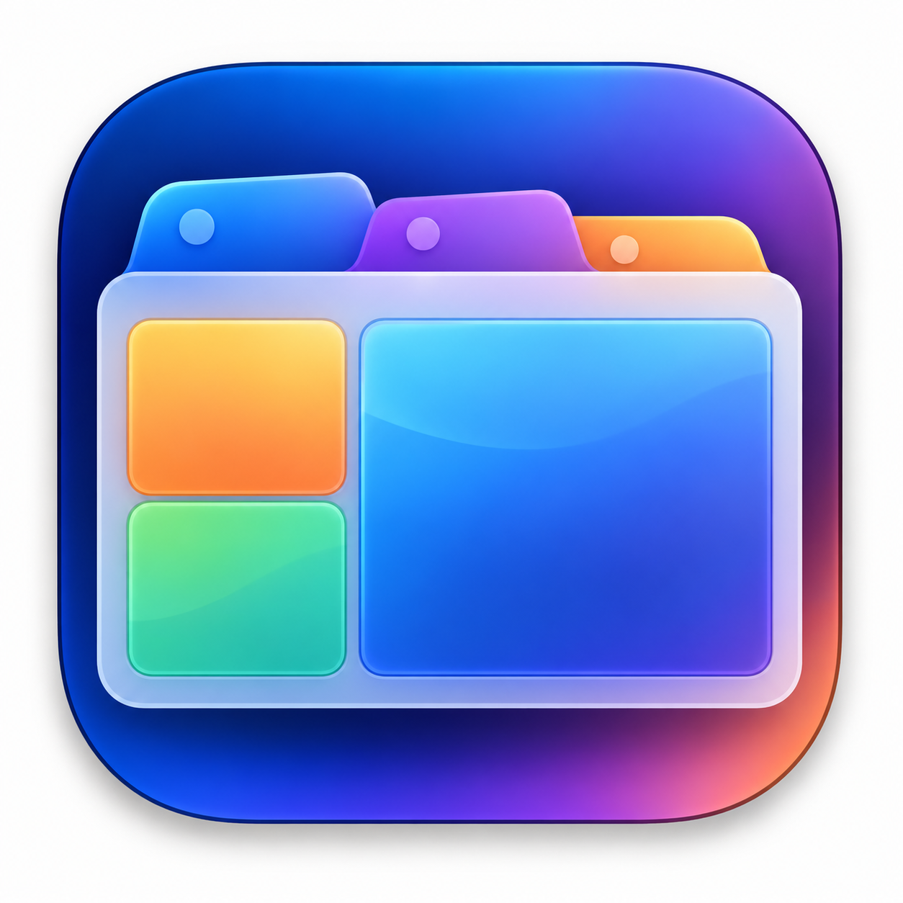
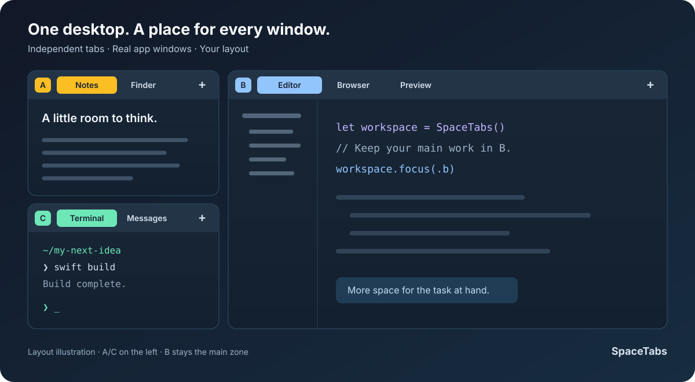

# SpaceTabs

> If you use X.com, check out my other projects at [captainx.team](https://captainx.team). Follow my open-source ideas and side projects on [X · @jrausell](https://x.com/jrausell).

<p align="center">
  
</p>

<h2 align="center">Your windows. Your zones. One desktop.</h2>

<p align="center">A native macOS window manager with independent tabs in every zone.</p>

<p align="center">
  <a href="#get-started">Get started</a> ·
  <a href="#how-it-works">How it works</a> ·
  <a href="#tab-spaces">Tab Spaces</a> ·
  <a href="#default-controls">Controls</a> ·
  <a href="#contributing">Contributing</a> ·
  <a href="#documentation">Documentation</a>
</p>

<p align="center">
  <a href="docs/assets/spacetabs-presentation.mp4">
    <picture>
      <source media="(prefers-reduced-motion: reduce)" srcset="docs/assets/readme-layout.svg">
      
    </picture>
  </a>
</p>

[Watch the full 70-second presentation](docs/assets/spacetabs-presentation.mp4). *Animated illustration, not a screen recording.*

SpaceTabs gives each part of your desktop its own group of app windows. Keep notes on the left, your main work in B, and a terminal nearby. Switch tabs inside one zone while the other zones keep their selections. **Choose which windows become tabs, and keep your other apps working as usual.**

Built with **Swift, SwiftUI, AppKit, and the public macOS Accessibility API**. No third-party Swift packages. Your windows stay in their original apps, with the normal macOS menu bar and Dock.

**Status:** working prototype for macOS 15+. Source builds are available; public release preparation is in progress. The current app manages **one selected display at a time**. The source code is available under [GNU GPLv3](LICENSE).

## How it works

1. **Choose a layout.** Start with two columns, or split the smaller column into A and C on either side of B.
2. **Assign your apps.** Put windows into a zone from Settings, or drag them onto a zone target.
3. **Switch within each zone.** Click a tab to bring its window forward. Other tabs stay open without being minimized.
4. **Bring your workspace back.** Choose SpaceTabs in Command-Tab or click its Dock icon to bring every zone's selected window forward, with final focus in B.

SpaceTabs Settings has its own Dock and Command-Tab entry, so you can return to configuration separately.

## Tab Spaces

A tab space is a group of real app windows in one area of your desktop. The areas are called **zones**, labeled **A**, **B**, and **C**. Each zone has its own tabs and selected window: switch from an editor to a browser in B while your notes in A and terminal in C stay selected.

**Only the windows you choose become tabs.** Keep your other windows and apps independent and use them normally through the Dock, Command-Tab, or a click. You can assign an individual window without assigning every window from that app.

Choose from three layout templates:

| Template | Arrangement |
| --- | --- |
| **Two Columns** | A on the left, B on the right. |
| **A/C on the Left** | A above C on the left, with B on the right. |
| **A/C on the Right** | B on the left, with A above C on the right. |

**Resize the layout to suit your work.** Drag the width handle to adjust the columns. In either A/C template, drag the height handle to change the split between A and C. B remains the main zone in every template.



*Example: A/C on the Left. Colors and app names illustrate the layout; appearance is configurable.*

## Make the desktop yours

| Feature | What you can do |
| --- | --- |
| Independent tab groups | Keep several real app windows in each zone and switch them independently. |
| Three layout templates | Use two columns, A/C on the left, or A/C on the right. B is always the main zone. |
| Visual resizing | Drag the width and height handles to adjust the layout. |
| Flexible tab bars | Keep bars fixed with reserved space, or let them float and hide. Customize colors and contrast. |
| Drag to organize | Reorder tabs, move them between zones, or assign a window with a modified drag. |
| Keyboard control | Customize shortcuts, navigate between zones, and search tabs and profiles. |
| Focused-window zoom | Temporarily expand the focused managed window, then restore its previous size. |
| Local profiles | Save layouts, tab selections, and app assignments. Link a profile to a display setup. |
| Languages | Follow your Mac automatically, or choose English or Español in Settings. |
| Everyday options | Name zones, start at login, and inspect persistent problem logs when an app behaves differently. |

Assigning a closed app saves a rule without launching it. Compatible windows can join the assigned zone when you open that app. Switch saved setups from **SpaceTabs → Profiles** in the menu bar or from Settings. Each profile can optionally open closed assigned apps when you switch manually; automatic display-profile changes keep closed apps closed. See [Profiles and monitors](docs/MONITORS.md) for the save-and-switch flow.

## Get started

### Requirements

- **macOS 15 or later.**
- **Xcode with Swift 6.** The reference toolchain is Xcode 26.3 / Swift 6.2.4.
- **Accessibility access** for the packaged SpaceTabs app to manage external windows.

### Build and open

From your local checkout:

```sh
Scripts/build-app.sh release
open dist/SpaceTabs.app
```

This packages SpaceTabs and its Settings helper. Use the packaged app as your normal installation so both app identities and icons are available.

Without a configured certificate, builds use an ad hoc signature and macOS may ask for Accessibility access again after updates. For regular development, configure a stable identity using the [signing guide](SIGNING.md). If signing fails, the previous app in `dist` is kept.

To compile without packaging or a personal signing identity:

```sh
Scripts/build.sh release
```

### Set up your first workspace

1. Open SpaceTabs and grant Accessibility access when requested.
2. In **Settings → Apps**, assign open windows or installed apps to a zone.
3. In **Design**, choose a template, select a display, and adjust the sizes.
4. Show the tab bars with **Control + Option + T**, then switch tabs.
5. Save your setup in **Profiles**. Use **Release** when you want a window back outside the layout.

For an external screen, see [Profiles and monitors](docs/MONITORS.md). Profiles can switch between display setups; independent layouts on multiple displays at once are not implemented yet.

## Default controls

`Control` is ⌃, `Option` is ⌥, `Shift` is ⇧, and `Command` is ⌘. Global shortcuts can be edited or disabled in **Shortcuts**.

| Action | Default control |
| --- | --- |
| Show tab bars | Control + Option + T |
| Search tabs and profiles | Control + Option + Space |
| Zoom or restore the focused managed window | Control + Option + Return |
| Focus A / B / C | Control + Option + 1 / 2 / 3 |
| Previous / next tab in the active zone | Control + Option + Left / Right |
| Move the selected tab to A / B | Control + Option + Shift + Left / Right |
| Move the selected tab to C | Control + Option + Shift + 3 |
| Release the selected window | Control + Option + Delete |
| Focus a neighboring zone | Control + Option + Command + arrow |
| Move to a neighboring zone | Control + Option + Command + Shift + arrow |
| Assign while dragging a normal window | Command + Shift + window drag |
| Assign from anywhere in a window | Control + right-button drag |
| Fill a window's own zone | Double-click its tab |
| Restore the selected windows in all zones | Command-Tab to SpaceTabs or click its Dock icon |

Control + right-drag is optional. It shows an outline after identifying the source window and moves the real window on release. Release Control before the button to cancel. While enabled, Control + right-click is reserved for this gesture; normal right-click remains available. See [Troubleshooting](docs/TROUBLESHOOTING.md) if it does not respond.

Moving the pointer to the top edge reveals tabs only if that option is enabled. It is off by default.

## Language

SpaceTabs starts in your Mac’s preferred supported language, with English as the fallback. Change it in **Settings → General → Language**. English and Spanish are included; see [Localization](docs/LOCALIZATION.md) to add another language.

## macOS behavior and limits

SpaceTabs draws its own controls and positions real external windows. It does not embed another app inside its own window. macOS controls application activation, window ordering, native Spaces, and native full screen. Some apps impose minimum window sizes, reject AX notifications, or stop responding to Accessibility.

A SpaceTabs zone is different from a macOS Space. SpaceTabs does not create or move native Spaces, and does not hide desktops by moving windows off screen. Desktop behavior needs testing with your apps and display setup; automated tests cover the underlying policies and coordination.

## Contributing

**SpaceTabs is maintainer-led. Please get agreement on a change before opening a pull request.**

Useful bug reports and focused proposals are welcome. Include reproduction steps or a concrete use case, and search existing issues first. An issue is a proposal, not permission to start a PR; wait for explicit maintainer agreement on scope.

Unsolicited PRs, cosmetic-only changes, unrelated refactors, and bulk generated fixes may be closed without review. Contributions made mainly to collect a credit or contributor badge are not a fit for this project. AI-assisted work must be reviewed, understood, and tested by its author.

You are welcome to use, modify, and fork the code under [GNU GPLv3](LICENSE). Upstream inclusion and maintainer access are separate decisions. See [CONTRIBUTING.md](CONTRIBUTING.md) for the full policy and checks; coding agents should also read [AGENTS.md](AGENTS.md).

## Documentation

| Guide | What it covers |
| --- | --- |
| [Profiles and monitors](docs/MONITORS.md) | Select a screen, save profiles, and handle disconnects and reconnects. |
| [Architecture](docs/ARCHITECTURE.md) | Source map, ownership, concurrency, and behavior contracts. |
| [Localization](docs/LOCALIZATION.md) | Language selection, translation catalogs, and adding a language. |
| [Development](docs/DEVELOPMENT.md) | Toolchain, scripts, formatting, and CI. |
| [Configuration](docs/CONFIGURATION.md) | Local files, validation, compatibility, and data safety. |
| [Testing](docs/TESTING.md) | Automated checks and real-desktop scenarios. |
| [Troubleshooting](docs/TROUBLESHOOTING.md) | Permissions, focus, gestures, and useful diagnostics. |
| [Signing](SIGNING.md) | Stable app identity and local development certificates. |
| [Roadmap](docs/ROADMAP.md) | Engineering priorities and public-release preparation. |
| [Changelog](CHANGELOG.md) | Source milestones and recent changes. |

## Author and license

Created and maintained by **Jorge Rausell**. Find more projects at [captainx.team](https://captainx.team) and follow [@jrausell](https://x.com/jrausell).

SpaceTabs source code is licensed under the **GNU General Public License, version 3 (GPLv3)**. See [LICENSE](LICENSE) for the full terms. Remaining asset and distribution checks are tracked in the [release roadmap](docs/ROADMAP.md).

If SpaceTabs helps you, [let me know how you use it](https://x.com/jrausell). A shout-out or link back is always appreciated, and entirely optional.

## Inspiration and related projects

These open-source projects are valuable references for macOS window management and helped inform the ideas behind SpaceTabs. Explore their approaches, options, and tradeoffs:

- [AeroSpace](https://github.com/nikitabobko/AeroSpace) — an i3-like tiling window manager for macOS.
- [Amethyst](https://github.com/ianyh/Amethyst) — automatic tiling for macOS, inspired by xmonad.
- [rift](https://github.com/acsandmann/rift) — a tiling window manager for macOS.
- [yabai](https://github.com/koekeishiya/yabai) — a macOS tiling window manager based on binary space partitioning. The repository now lives at [asmvik/yabai](https://github.com/asmvik/yabai).

Thank you to their maintainers and contributors. SpaceTabs focuses on independent tab groups inside visible zones; each project has its own design and implementation. See the [design research notes](docs/RESEARCH.md) for more context.
